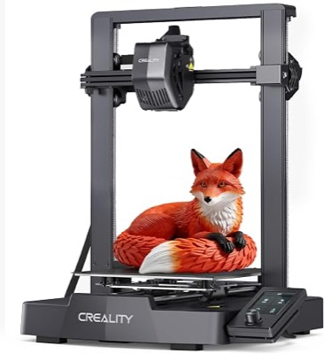
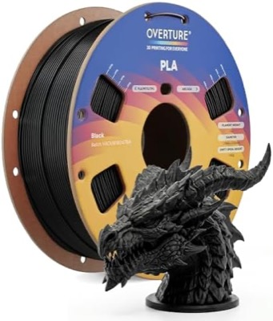
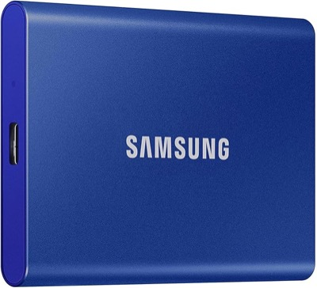

# Ollama Image Studio

<p align="center">🇺🇸 <b>English</b> · 🇫🇷 <a href="README.fr.md">Français</a></p>

A native macOS app to generate, locally, **images**, **3D models (STL)** from a prompt, and **3D models from a photo** — without touching the terminal. Built with Electron + React, designed for Apple Silicon.


## Features

The app has **three modes**, selectable at the top of the panel:

### 🖼️ Image mode
- Image generation with the `x/z-image-turbo` model (shown **in red** with the install command if it isn't present).
- Settings: width / height (512–2048), number of steps, *seed* (+ random button 🎲).
- Saved to `~/Pictures/OllamaImageStudio/`.

### 🧊 3D STL mode
- Free choice of the **code** model among the ones installed locally.
- Pipeline: *prompt → the model writes [JSCAD](https://github.com/jscad/OpenJSCAD.org) code → compiled to STL inside the app → 3D render*.
- **Interactive 3D viewer** (mouse rotation, scroll-wheel zoom) with Three.js.
- **"View code"** button to inspect the generated JSCAD code.
- The `.stl` is saved to `~/Documents/OllamaImageStudio/`.
- Robustness: detailed *system prompt* + forgiving compatibility layer + **self-repair** (if the code fails, the error is sent back to the model for a fix, up to 3 attempts).

### 🗿 Image → 3D mode (Hunyuan3D, advanced)
- Turns **an image** (photo or generated image) into a **3D model** with [Hunyuan3D 2.1](https://github.com/Tencent-Hunyuan/Hunyuan3D-2.1) running **locally on Apple Silicon** (MLX).
- Choice of the number of steps, **configurable STL size (mm)** for printing, and optional **color texture (PBR)**.
- 3D viewer, **GLB** export (with color) and **STL** export (for 3D printing, scaled).
- ⚙️ **Requires a separate local server** (see [Image → 3D mode: setup](#image--3d-mode-setup-local-server)). Without it, the mode shows "server off".
- ⏱️ ~9 min for the shape, ~9 more min with the texture (on an M2 Pro).

### Common to all modes
- ✅ Automatic check of the Ollama connection + model detection.
- 🗂️ Gallery of the last 20 generations (click = reloads the settings). Metadata saved to disk.
- ⏹️ Generation can be cancelled at any time.
- 📋 Copy the prompt, 📂 reveal the file in Finder.
- 🌙 Dark theme, native macOS title bar.

## Requirements

- macOS (Apple Silicon recommended)
- [Ollama](https://ollama.com) installed and running: `ollama serve`
- **For images**: `ollama pull x/z-image-turbo`
- **For STL**: a code model. Recommended for the best quality:
  a *cloud* model such as `gpt-oss:120b-cloud`; locally, `qwen2.5-coder` works too.
- Node.js 18+ (to build from source)

> **Note**: image generation through Ollama's `/api/generate` is an experimental API endpoint.
> For STL, quality depends heavily on the code model you pick: more powerful
> models produce much more detailed shapes.

## Run from source

```bash
git clone https://github.com/koua29/ollama-image-studio.git
cd ollama-image-studio
npm install
npm run dev      # starts Vite + Electron in development mode
```

## Build a distributable app

```bash
npm run build    # produces a .app and a .dmg in release/
```

Then drag **Ollama Image Studio.app** into your `/Applications` folder, or open the `.dmg`.

## Image → 3D mode: setup (local server)

The **Img→3D** mode relies on Hunyuan3D 2.1 (MLX port), which runs in a **small separate Python server** (the app talks to it on `http://127.0.0.1:8765`). It's an **advanced** feature, separate from the core of the app.

Requirements: Apple Silicon Mac (32 GB recommended), Python 3.11, ~14 GB of model weights.

1. Get the MLX pipeline and the weights ([dgrauet/Hunyuan3D-2.1-mlx](https://github.com/dgrauet/Hunyuan3D-2.1-mlx), weights on [Hugging Face](https://huggingface.co/dgrauet/hunyuan3d-2.1-mlx)).
2. Create a venv and install the dependencies (`requirements-mlx.txt`).
3. Start the server. **The installed app starts it automatically when it opens**
   (and stops it when it closes) as long as the `hunyuan3d-mlx` folder and its venv
   exist at the expected location — nothing to do. As a fallback / outside the app, a
   double-clickable script is provided:
   ```
   ./start-3d-server.command
   ```
   The badge switches to "server OK" in the app.

> Location expected by the auto-start: `~/Documents/Claude/Projects/hunyuan3d-mlx`
> (can be overridden with the `OIS_3D_SERVER_DIR` environment variable).

> Without this server, the **Image** and **STL** modes work normally; only **Img→3D** is disabled.

### Image tips for good results (Img→3D)

The pipeline **does not remove the background** automatically: the quality of the 3D model
depends directly on a clean input image. Prefer a **PNG with a transparent
background** (cut-out object) — the app composites it onto white by itself.

| Criterion | Recommendation |
|---|---|
| **Format** | **Transparent-background PNG** (ideal); otherwise PNG/JPG on a **pure, plain white background** |
| **Subject** | a **single object**, with good contrast against the background |
| **Framing** | object **centered**, filling ~80–90% of the image, **not cut off** at the edges |
| **Ratio** | **close to square** (a very elongated format ⇒ smaller object ⇒ less detail) |
| **View** | **clear front view** (the model infers the back from this view) |
| **Lighting** | **even**, avoid hard shadows (they turn into relief) |
| **Resolution** | ~1024 px is enough (the encoder resizes anyway) |

Avoid: busy/real-world backgrounds, cast shadows, low object/background contrast,
heavily compressed JPG (artifacts on the edges).

## Architecture

```
ollama-image-studio/
├── electron/
│   ├── main.js       # main process: IPC, Ollama HTTP calls, JSCAD→STL pipeline
│   └── preload.js    # contextBridge — exposes a safe window.ollama API
└── src/
    ├── App.jsx       # application state
    └── components/   # Header, PromptPanel, ImageViewer, StlViewer, Gallery
```

**Technical choices**

- All HTTP calls to Ollama are made in the **main process** (Node's `http` module, zero dependencies) — no CORS issues and the *renderer* stays isolated.
- The JSCAD code generated by the model runs in a **locked-down `vm` sandbox** (no file/network access, time-bounded execution), then is serialized to STL.
- Security: `nodeIntegration: false`, `contextIsolation: true`, `sandbox: true`, plus a strict Content-Security-Policy.

## 🛒 Hardware

*Amazon affiliate links: if you buy through these links, the project earns a small commission at no extra cost to you.*

<table>
<tr>
<td align="center" width="33%">
  <a href="https://www.amazon.com/dp/B0DD7F2BH9?linkCode=ll2&amp;tag=koua29ollamaimagestu-20&amp;ref_=as_li_ss_tl"></a><br>
  <b><a href="https://www.amazon.com/dp/B0DD7F2BH9?linkCode=ll2&amp;tag=koua29ollamaimagestu-20&amp;ref_=as_li_ss_tl">Creality Ender-3 V3 SE</a></b><br><sub>To print the STL files the app generates</sub>
</td>
<td align="center" width="33%">
  <a href="https://www.amazon.com/dp/B07PGY2JP1?linkCode=ll2&amp;tag=koua29ollamaimagestu-20&amp;ref_=as_li_ss_tl"></a><br>
  <b><a href="https://www.amazon.com/dp/B07PGY2JP1?linkCode=ll2&amp;tag=koua29ollamaimagestu-20&amp;ref_=as_li_ss_tl">OVERTURE PLA 1.75 mm</a></b><br><sub>The filament to go with the printer</sub>
</td>
<td align="center" width="33%">
  <a href="https://www.amazon.com/dp/B0874YJP92?linkCode=ll2&amp;tag=koua29ollamaimagestu-20&amp;ref_=as_li_ss_tl"></a><br>
  <b><a href="https://www.amazon.com/dp/B0874YJP92?linkCode=ll2&amp;tag=koua29ollamaimagestu-20&amp;ref_=as_li_ss_tl">Samsung T7 1 TB</a></b><br><sub>Ollama models and STL files take up space</sub>
</td>
</tr>
</table>

<sub>As an Amazon Associate I earn from qualifying purchases.</sub>

## ☕ Buy me a coffee

This app is free and open source. If you find it useful, you can say thanks
by buying me a coffee — just scan this PayPal QR code. Thanks a lot! 🙏

<p align="center">
  
</p>

## License

[MIT](LICENSE) © 2026 koua29
